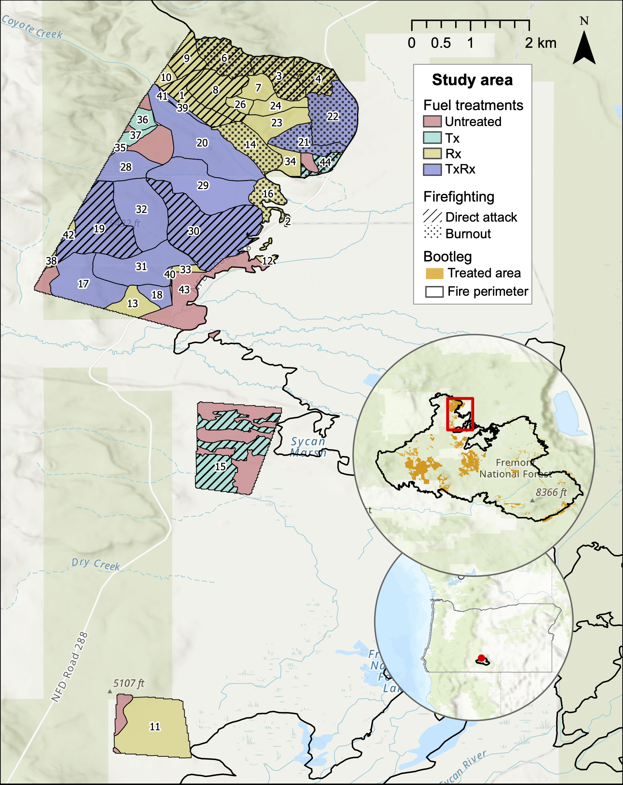
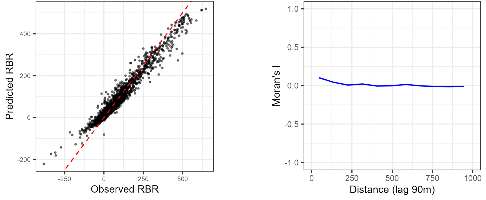
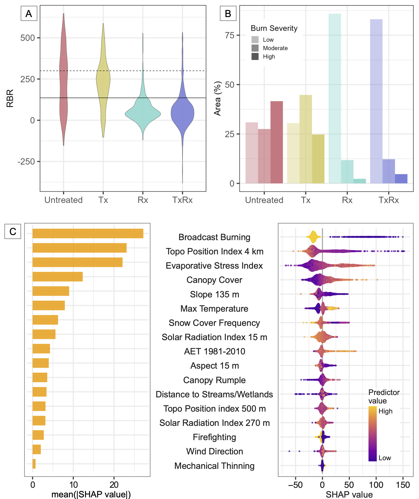
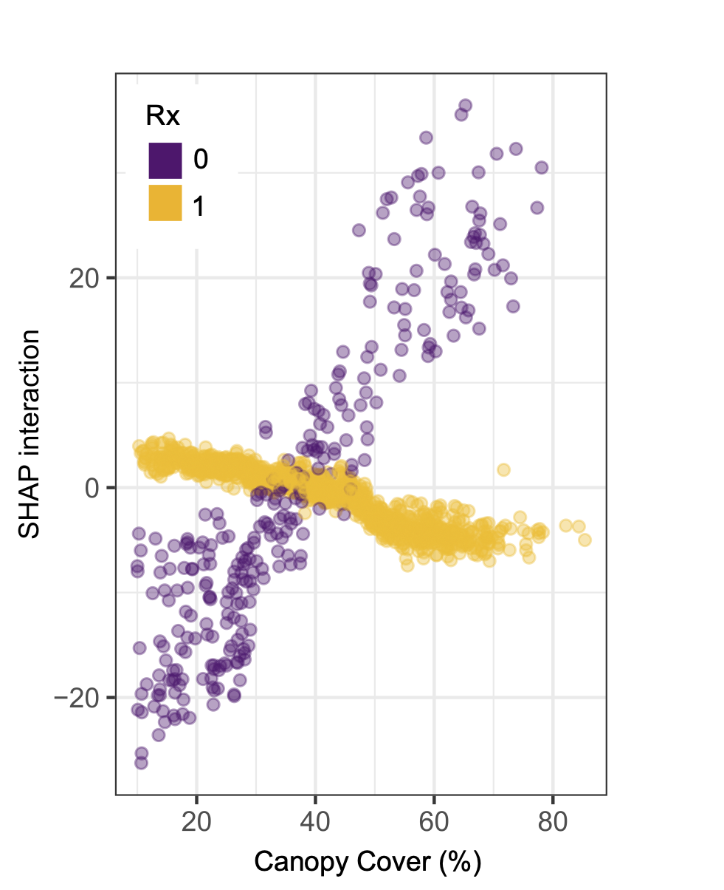

Fuel treatments and burn severity near Sycan Marsh (2021 Bootleg Fire):
Random Forest and SHAP analysis
================

**Astrid Sanna** · <astridsannawork@gmail.com>

Code and summary for [Sanna, A., et al. (2025). *Fire Ecology*, 21:
44.](https://link.springer.com/article/10.1186/s42408-025-00387-y)
Listen to the [podcast](https://fireecology.org/feco-podcast/ep69) for a
deeper dive into this study.

## Overview

### The importance of fuel treatments

As U.S. dry forest structure has increasingly departed from historic
conditions — mostly due to fire suppression and the exclusion of
Indigenous fires — restoring forests by reducing fuel accumulation
through thinning and broadcast burning is critical to promote beneficial
wildfires.

### The challenge and opportunity

Understanding the effect of fuel treatments on burn severity, as well as
their interaction with fire suppression operations relative to other
drivers, is often challenged by the availability and accuracy of fuel
treatment data, limited local knowledge, and the confounding influence
of variable fire weather conditions.

### What sets this study apart

Focusing on an 1800-ha section of the Bootleg Fire near Sycan Marsh
(south-central Oregon), where pre-fire LiDAR data were available, we
isolated and investigated the effects of broadcast burning, thinning,
both treatments combined, and fire-suppression operations — alongside
other environmental predictors — under constant severe fire-weather
conditions. We also leveraged local knowledge provided by land and fire
managers, as well as accurate fuel treatment data representing 41
treatment units.

To interpret the results of our Random Forest model, we employed Shapley
Additive exPlanations (SHAP) analysis, which provided both a global
overview of mean predictor effects and a spatially explicit assessment
of local variability. This approach captured complex predictor
interactions and revealed spatially variable relationships at the scale
of individual observations that would have otherwise been overlooked.

### Key messages

- Fuel treatments involving broadcast burning were disproportionately
  more effective in mitigating burn severity than thinning alone or
  untreated forests.
- Broadcast burning alone was as effective as thinning combined with
  broadcast burning, reducing management costs and soil disturbance.
- Under constant severe fire weather conditions, fuel characteristics —
  including fuel treatments and their local variability — played a
  central role in influencing burn severity.
- This study provides a reproducible framework for explaining burn
  severity at both global and local scales.

*Adapted from the [research
highlight](https://fireecology.org/journal-news/rh-burnseverity) I wrote
for the Association for Fire Ecology (2025).*

## Study area and data

The study area is the footprint of a 2018 LiDAR acquisition near Sycan
Marsh (Fremont-Winema National Forest, south-central Oregon), within the
Bootleg Fire perimeter. It includes untreated forest and areas treated
with broadcast burning (Rx), thinning (Tx) or both, as well as
firefighting operations.



## Methods

> Some of the data are not public, so the code is displayed but not
> executed. Figures are from the published analysis.

``` r
library(sf)           # vector data: st_read, st_transform, st_coordinates
library(terra)        # rasters: rast, crop, mask, aggregate, extract
library(raster)       # raster() used to read the predictor layers
library(tools)        # file_path_sans_ext (predictor names from file names)
library(dplyr)        # rename, mutate, filter, case_when, row_number
library(tidymodels)   # recipe, rand_forest, vfold_cv, grid_regular, tune_grid, workflow
library(ranger)       # random forest engine
library(caret)        # rfe, rfeControl (recursive feature elimination)
library(randomForest) # needed by caret's rfFuncs
library(doParallel)   # makeCluster, registerDoParallel (parallel tuning)
library(vip)          # variable importance plot
library(DALEX)        # model_performance, model_diagnostics
library(DALEXtra)     # explain_tidymodels
library(ggplot2)      # plots
library(sp)           # SpatialPointsDataFrame (input for elsa)
library(elsa)         # correlogram (Moran's I of residuals)
library(treeshap)     # ranger.unify, treeshap
library(shapviz)      # shapviz, sv_importance, sv_dependence
```

### 1. Extracting and compiling data

Burn severity was sampled on a regular 90 m grid (the center pixel of
each 90 × 90 m block), and each predictor was extracted at the sample
points. Points with less than 10% canopy cover and incomplete records
were removed, leaving 1,846 points.

``` r
# Set seed to obtain consistent results
set.seed(1)

# Primary directory
pdir <- "data/" 

# Read in burn severity
RBR <- rast(paste0(pdir, "burn_severity/BOOTLEG_BurnSeverity_S2_BOA_RBR_10m.tif")) 

# Read in fire perimeter - for Sycan is the 2018 LiDAR footprint within Bootleg
stdy <- st_read(paste0(pdir, "All_TNC_USFS_treatments_LiDAR_2018_Bootleg_v6/All_TNC_USFS_treatments_LiDAR_2018_Bootleg_v6.shp"))  
stdy <- st_zm(stdy)
stdy_m <- stdy # this will be used to assign XY coordinates with metric projection

# Set predictor variable file
pred_fil <- paste0(pdir, "modeling_layers_Sycan_v10/") 

# Aggregation function for sampling
agFunc <- function(x) {sum(x*c(rep(0,40),1,rep(0,40)))} # sample at 90 m
# 90/10 = 9; ((9*9)-1)/2 # 40

# Crop severity to fire perimeter and aggregate to 90m spacing
stdy <- st_transform(stdy, st_crs(RBR))
RBR_crop <- mask(crop(RBR, vect(stdy)), vect(stdy))
RBR <- RBR_crop

# Aggregate for sampling
RBR_ag <- terra::aggregate(RBR_crop, 9, fun = agFunc) # 90m

# Create point layer 
pnts <- st_as_sf(as.points(RBR_ag))

# Add coordinates to pnts shapefile 
pnts <- st_transform(pnts, crs(stdy_m))
pnts_xy <- st_coordinates(pnts) # extract xy coordinates 
pnts <- cbind(pnts, pnts_xy)

# Input variables to build dataframe
fils <- list.files(pred_fil, full.names = T)
mets <- list.files(fils, full.names = T, recursive = T)
mets <- mets[grepl(".img$|.tif$|.asc$", mets)]
metsnms <- file_path_sans_ext(basename(mets))
pred_rasts <- lapply(mets, raster) 
length(pred_rasts) # 74 rasters 

# Extract each predictor to points
these_pnts <- st_transform(pnts, st_crs(pred_rasts[[1]]))
these_vals <- terra::extract(rast(pred_rasts[[1]]), vect(these_pnts))

pred_df <- data.frame("var" = these_vals[,2])
names(pred_df) <- metsnms[1]

for (i in 2:length(pred_rasts)) { 
  these_pnts <- st_transform(pnts, st_crs(pred_rasts[[i]]))
  these_vals <- terra::extract(rast(pred_rasts[[i]]), vect(these_pnts))
  
  this_df <- data.frame("var" = these_vals[,2])
  names(this_df) <- metsnms[i]
  
  pred_df <- cbind(pred_df, this_df)
  print(i)
} 

# Create full df 
full_df <- pnts
this_pred_df <- pred_df %>%
  rename(ecostress_esi = `ECOSTRESS_L4_ESI_PT-JPL_17070_007_20210710T124004_0601_01_ESIavg_GEO`, 
         Sycan_treatments = Sycan_treatments_rast)
st_geometry(full_df) <- NULL 
full_df <- cbind(full_df, this_pred_df)
dim(full_df) 

# Removed unwanted columns (vars with more than 50 NA were not important in 
# previous RF iterations)
na_counts_per_column <- colSums(is.na(full_df))
na_count_per_column <- as.data.frame(na_counts_per_column)
column_50plusNA <- na_count_per_column %>%
  dplyr::filter(na_count_per_column > 50)
column_50plusNA <- rownames(column_50plusNA)
full_df <- full_df %>%
  dplyr::select(- column_50plusNA) %>%
  filter(FIRST_RETURNS_all_cover_above2_30METERS > 10) # remove all pixels with < 10% canopy cover
dim(full_df) 

# Removing all rows with NA
full_df <- full_df[complete.cases(full_df),]
dim(full_df) # 1846  
full_df <- full_df %>%
  mutate(Treatment_type = case_when(
    Sycan_treatments == 0 ~ "Untreated",
    Sycan_treatments == 1 ~ "Rx",
    Sycan_treatments == 2 ~ "Tx",
    Sycan_treatments == 3 ~ "TxRx"
  )) 

# Edits: 
# - simplify Sycan treatments to treatment/no-treatment and Rx/no-Rx
# - simplify EVT to dominant/non-dominant vegetation
full_df <- full_df %>%
  mutate(Fuel_treatments = Sycan_treatments,
         Rx = Sycan_treatments,
         Tx = Sycan_treatments,
         EVT_PP = EVT_GP_220
         ) %>%
  mutate(
    Fuel_treatments = ifelse(Fuel_treatments %in% c(0), 0, ifelse(Fuel_treatments %in% c(1, 2, 3), 1, Fuel_treatments)),
    Rx = ifelse(Rx %in% c(0, 2), 0, ifelse(Rx %in% c(1, 3), 1, Rx)),
    Tx = ifelse(Tx %in% c(0, 1), 0, ifelse(Tx %in% c(2, 3), 1, Tx)),
    EVT_PP = ifelse(EVT_PP == 2, 1, 0) #2 = 631 = Ponderosa Pine Forest, Woodland and Savanna
  ) %>%
  dplyr::select(-c(EVT_GP_220, 
            Sycan_treatments,
            Fuel_treatments,
            burn_prog_IR_20230501))
  
dim(full_df) 
```

### 2. Removing collinear predictors

For each pair of predictors with \|Spearman ρ\| ≥ 0.6, the one less
correlated with RBR was removed. The largest remaining correlation was
0.59.

``` r
# * Reduce datasets based on collinearity and relationship with RBR ----
# Initialize a vector to keep track of removed variables
removed_vars <- list()
# save full_df variable names as pred_nms excluding one-hot-encoded treat., 
# Treatment_type, EVT_PP, and coordinates variables 
names(full_df) <- make.names(names(full_df)) # R friendly names 
pred_nms <- full_df %>%
  dplyr::select(- X, - Y, -Treatment_type, -Sycan_firefighting_opt_rast) %>%
  colnames()
print(pred_nms)
# Create a vector of variables to check for high correlation. Initially, it includes all predictor names.
vars_to_check <- pred_nms

# Loop until all variables have been checked for high correlation
while (length(vars_to_check) > 0) {
  this_met <- vars_to_check[1]                   # Start with the first variable
  vars_to_check <- vars_to_check[-1]             # Remove the variable from the list, as it's being checked now
  
  # Loop through the remaining variables to check correlation against the current variable (this_met)
  for (j in vars_to_check) {
    sec_met <- j                                 # Set the second variable for comparison
    # Filter out rows with missing values for both columns and target 'RBR'
    complete_rows <- complete.cases(full_df[, c(this_met, sec_met, "RBR")])
    
    # Only calculate correlation if there are rows without NA values
    if (length(complete_rows) > 0) {
      # Calculate Spearman correlation between the two variables
      this_cor <- abs(cor(full_df[complete_rows, this_met], full_df[complete_rows, sec_met], method = "spearman"))
      
      # If the correlation is above the threshold (0.6 in this case)  
      if (this_cor >= 0.6) {
        # Calculate correlation of each variable with the target 'RBR'
        cor_one <- abs(cor(full_df[complete_rows, this_met], full_df[complete_rows, "RBR"], method = "spearman"))
        cor_two <- abs(cor(full_df[complete_rows, sec_met], full_df[complete_rows, "RBR"], method = "spearman"))
        
        # Decide which variable to remove based on their correlation with the target 'RBR'
        if (cor_one > cor_two) {
          removed_vars <- c(removed_vars, sec_met)  # Remove the second variable
          cat("Variable removed:", sec_met, "\n")
          # Also remove the second variable from the list of variables yet to check
          vars_to_check <- vars_to_check[vars_to_check != sec_met]
        } else {
          removed_vars <- c(removed_vars, this_met) # Remove the first variable
          cat("Variable removed:", this_met, "\n")
          break
        }
      }
    }
  }
}

# remove the "removed_vars" from the full_df 
removed_vars <- unlist(unique(removed_vars))
length(removed_vars) 
kept_vars <- pred_nms[!pred_nms %in% removed_vars]
length(kept_vars)
print(kept_vars)

# new dataframe with reduced set of predictors
slim_df <- dplyr::select(full_df, !c(all_of(removed_vars))) 
dim(slim_df) 

# remove treatment type var from slim_df since categorical variables can't be used in later local importance modeling 
slim_df <- slim_df %>%
  dplyr::select(-Treatment_type)
dim(slim_df) # 1846   23
slim_df_orig <- slim_df # save original slim_df

# check correlations as test
cors <- list()

slim_df <- slim_df %>%
  dplyr::select(-c(X, Y)) 

for (i in 2:ncol(slim_df)) {
  this_met <- colnames(slim_df)[i]
  for (j in 2:ncol(slim_df)) {
    sec_met <- colnames(slim_df)[j]
    if (this_met != sec_met) {
      cors <- c(cors, cor(slim_df[,this_met], slim_df[,sec_met], method = "spearman"))
    }
  }
}

cors <- abs(unlist(cors))
max(cors) # 0.5949759, good!

# Restore original slim_df
slim_df <- slim_df_orig
```

### 3. Feature selection and random forest

Predictors were selected with recursive feature elimination (repeated
cross-validation). A random forest (`ranger`) was then tuned with
10-fold cross-validation over `mtry` and `min_n`.

``` r
set.seed(1)
# Rename variables 
slim_df_new_names <- slim_df %>%
  rename(RBR = RBR,
         Y = Y,
         X = X,
         Distance_to_Streams_Wetlands = distance_to_streams_wetlands, 
         AET_1981_2010 = 'aet_1981-2010', 
         Ecostress_ESI = ecostress_esi,
         Max_Temp = tmmx, 
         Canopy_Rumple = canopy_rumple_30METERS,
         Canopy_Cover = FIRST_RETURNS_all_cover_above2_30METERS,
         Aspect_15m = topo_aspect_15M_15METERS,
         Curvature_45m = topo_curvature_45M_15METERS,
         Plan_Curvature_15m = topo_plancurv_15M_15METERS,
         Slope_135m = topo_slope_135M_15METERS,
         Solar_Radiation_Index_15m = topo_sri_15M_15METERS,
         Solar_Radiation_Index_270m = topo_sri_270M_15METERS,
         Topo_Position_Index_4km = topo_tpi_4000M_15METERS, 
         Topo_Position_Index_500m = topo_tpi_500M_15METERS, 
         Snow_Cover_Frequency = scf,
         Wind_Direction = northsouthness_mx_speed_direction_Sycan_90m,
         Prescribed_Fire = Rx,
         Firefighting = Sycan_firefighting_opt_rast,
         Mechanical_Thinning = Tx, 
         Dominant_Vegetation = EVT_PP)
colnames(slim_df_new_names)
slim_df <- slim_df_new_names
slim_df_v23 <- slim_df

# Classify severity for stratified sampling
slim_df$RBR_cls <- findInterval(slim_df$RBR, c(-Inf, 136, 300, Inf)) # example for RBR table 7 (GEE derived RBR, excludes offset), Parks et al 2018

slim_df <- slim_df %>%
  mutate(Unique_ID = paste(row_number(), RBR_cls, sep = "_"))
dim(slim_df) 

# Define initial RF model 
set.seed(1)
rfe_df <- slim_df %>%
  dplyr::select(-c(X, Y, RBR_cls, Unique_ID))

# RFE (Recursive Feature Elimination) with default gini impurity using caret 
# Setup the control using repeated cv
control <- rfeControl(functions = rfFuncs, 
                      method = "repeatedcv", 
                      repeats = 5,
                      verbose = FALSE)

# Run the Recursive Feature Elimination (RFE)
results <- rfe(rfe_df[, -which(names(rfe_df) == "RBR")], 
               rfe_df$RBR, 
               metric = "Rsquared",
               sizes = c(1:ncol(rfe_df)-1), 
               rfeControl = control)

# Print the results
print(results)
rfe_results <- results
selected_vars <- predictors(results)
print(selected_vars) # Mechanical_Thinning was discarded. 

# Add Mechanical_Thinning back to the data frame for the purpose of this study.
Tx_df <- slim_df_v23 %>%
  dplyr::select(Mechanical_Thinning)

slim_df <- slim_df %>%
  dplyr::select(RBR, X, Y, RBR_cls, Unique_ID, all_of(selected_vars)) %>%
  rename(Evaporative_Stress_Index = Ecostress_ESI) %>%
  cbind(Tx_df)

colnames(slim_df)

# Model specs (explained below):
# tune_spec is my model specification, which describes the type of model I want to fit and which hyperparameters I want to tune.
# rf_grid provides the specific values of those hyperparameters that will be tried out during the tuning process.
# tune_wf combines my data preprocessing steps and my model into a workflow that can be fit to data.

set.seed(1)
df_RF <- slim_df

# Prepare recipe 
rec <- recipe(RBR ~., data = df_RF) %>%
  update_role(RBR_cls, new_role = "ID") %>%
  update_role(X, new_role = "Coordinates") %>%
  update_role(Y, new_role = "Coordinates") %>%
  update_role(Unique_ID, new_role = "Unique_ID")

# Model specification
tune_spec <- rand_forest(mtry = tune(), min_n = tune()) %>% # autopilot model 
  set_engine("ranger", importance = "permutation") %>% 
  set_mode("regression")
trees_folds <- vfold_cv(df_RF, v = 10) # data divided in 10 equal groups, 9 used for training, 1 for testing. each time a different group is used for testing and then the performance is averaged 

# Set up grid for hyper-parameter tuning
set.seed(1)
# Adjust the mtry range to cover all predictors and set min_n starting from 5 to avoid potential overfitting.
rf_grid <- grid_regular(mtry(range = c(1, ncol(slim_df)-5)), min_n(range = c(5,40)), levels = 10) 
# removed 5 non-predictors; levels = 10: this tells the function to create 10 evenly spaced points within each of these ranges. E.g. 10 values for mtry
tune_wf <- workflow() %>% add_recipe(rec) %>% add_model(tune_spec) # workflow is a set of functions telling the model: here is the recipe and the model you are going to run

# Tune rf model 
cl <- makeCluster(12) # creates a parallel computing cluster with 12 cores 
registerDoParallel(cl) #  enables parallel computation
tune_res <- tune_grid(tune_wf, resamples = trees_folds, grid = rf_grid) # this can take a few minutes.
mets <- tune_res %>% collect_metrics()
best_rf <- select_best(tune_res, "rsq");best_rf
final_worflow <- tune_wf %>% 
  finalize_workflow(best_rf) %>% 
  fit(data = df_RF)

# Extract model 
model <- extract_fit_parsnip(final_worflow)
model <- model$fit
class(model) # ranger

# Variable importance from the final model
(init_imps <- model %>% vip(num_features = ncol(df_RF))) 
slim_df_v24 <- slim_df

# Model performance 
my_explainer <- explain_tidymodels(final_worflow, data = dplyr::select(df_RF,  -c(RBR)), #
                                   y = as.integer(df_RF$RBR), verbose = TRUE) 

print(final_worflow)
# Type:                             Regression 
# Number of trees:                  500 
# Sample size:                      1846 
# Number of independent variables:  17 
# Mtry:                             4 
# Target node size:                 5 
# Variable importance mode:         permutation 
# Splitrule:                        variance 
# OOB prediction error (MSE):       5261.538 
# R squared (OOB):                  0.6802979 

model_perf <- DALEX::model_performance(my_explainer); model_perf # train model 
# Measures for:  regression
# mse        : 1014.139 
# rmse       : 31.84555 
# r2         : 0.9383454 
# mad        : 15.99328
```

The model was fit to all samples for explanation (R² = 0.94, RMSE =
31.8, as reported in the paper). Out-of-bag R² = 0.68 shows the learned
patterns hold for samples withheld from each tree.

### 4. Model fit and residual spatial autocorrelation

A Moran’s I correlogram of the residuals (90 m lags) checked that
spatial autocorrelation was not inflating model performance.

``` r
# Check model diagnostics 
md <- model_diagnostics(my_explainer)

# Model fit
slim_df_yhat <- as.data.frame(md) %>%
  dplyr::select(Unique_ID, X,Y, y, y_hat, residuals) %>%
  mutate(mu_y_hat = mean(y_hat)) %>%
  mutate(deviation = y_hat - mu_y_hat)
colnames(slim_df_yhat)
head(slim_df_yhat)

# Plot observed rbr vs RBR y-hat
plot_fit <- ggplot(slim_df_yhat, aes(x = y, y = y_hat)) + 
  geom_point(color = "black", alpha = 0.5, size = 0.5) +  
  geom_abline(intercept = 0, slope = 1, linetype = "dashed", color = "red", linewidth = 0.5) +  
  labs(x = "Observed RBR", y = "Predicted RBR", title = "Model fit") +
  theme_bw() +
  theme(
    text = element_text(size = 8),  # Increase the text size for the entire plot
    axis.title = element_text(size = 10))  # Specifically increase the axis label size
print(plot_fit)

# Residuals spatial autocorrelation
# Extract residuals
rsdls_df <- as.data.frame(md) %>%
  dplyr::select(Unique_ID, X,Y, residuals)
dim(rsdls_df)    

# Create sptdf object for Moran's I correlogram
rsdls_RBR_v <- as.data.frame(rsdls_df$residuals)
RBR_sptdf<- SpatialPointsDataFrame(coords = rsdls_df[, 2:3],
                                   data = rsdls_RBR_v) 

# Moran's I correlogram w/ point layer residuals (all points) 
co_rsd <- elsa::correlogram(RBR_sptdf, width = 90) 
dista_rsd <- co_rsd@correlogram$distance
mor_rsd <- co_rsd@correlogram$moran
df_rsd <- cbind(dista_rsd, mor_rsd)
df_rsd <- as.data.frame(df_rsd)
df_rsd$dista_rsd <- as.numeric(df_rsd$dista_rsd)
df_rsd$mor_rsd <- as.numeric(df_rsd$mor_rsd)

# Create Moran's I figure residuals
morans_rsdls_fig <- ggplot(df_rsd) +
  geom_line(aes(x = dista_rsd, y = mor_rsd), linewidth = 0.6, color = "blue") +
  theme_bw() +
  #scale_color_manual("Metric", values = c(str_cols, topo_cols, weather_cols)) +
  labs(x = "Distance (lag 90m)", y = "Moran's I") +
  xlim(0, 1000) +
  ylim(-1, 1) +
  labs(title = "Residuals spatial autocorrelation") +
  theme(text = element_text(size = 8),  # Adjust size as needed
        axis.text = element_text(size = 8),  # Adjust size as needed
        axis.title = element_text(size = 10))  # Adjust size as needed
print(morans_rsdls_fig)
```



*Model fit and residual spatial autocorrelation (Moran’s I)*

### 5. Interpreting the model with SHAP

Once the model was judged adequate, `treeshap` gave global importance
(mean \|SHAP\|), local effects for each point, and interactions between
predictors.

``` r
# Run shap analysis
model <- readRDS("my_model_v24.rds") 
model_unified <- ranger.unify(model, slim_df_v24) 
model_unified_df <- model_unified$model # all model parts  
treeshap_res <- treeshap(model_unified, slim_df_v24, interactions = T)  

# Prepare data for plots
x <- colnames(treeshap_res$shaps)
shap_df <- treeshap_res$shaps
sv <- shapviz(treeshap_res)
dim(sv) 

# Beeswarm plot - local importance
bees_p <- sv_importance(sv, max_display = 18L, kind = "beeswarm", 
                        alpha = 0.6, size = 0.2) +
  theme_bw() +
  theme(axis.text.y = element_text(size = 9), #element_blank(), color = ("black")
        axis.ticks.y = element_blank(), 
        axis.text.x = element_text(size = 9),
        axis.title.x = element_text(size = 9),
        legend.title = element_text(size = 8)) +
  scale_color_viridis_c(option = "plasma", 
                        begin = 0.1, end = 0.9, 
                        guide = guide_colourbar(
                          barwidth = unit(0.3, "cm"), 
                          barheight = unit(2, "cm"),
                          label = FALSE,  # Draw an upper limit
                          ticks = FALSE ,
                          title = "Predictor\nvalue"))  # Draw a lower limit
bees_p <- bees_p +
  theme(legend.position = c(0.8, 0.2), # Adjust these values as needed
        legend.margin = margin(t = 0, r = 0, b = 0.0, l = 0, unit = "pt"),
        legend.box.margin = margin(t = 0, r = 0, b = 0, l = 0, unit = "pt"),
        legend.spacing.x = unit(0, "cm"), # Adjust spacing between legend and plot
        legend.spacing.y = unit(0, "cm"),
        legend.title = element_text(size = 8, margin = margin(b = 2, unit = "pt"))) 
bees_p <- bees_p +
  theme(axis.text.y = element_text(size = 9, hjust = 0.5, 
                                   margin = margin(r = 7, unit = "pt"))) # Attempt to center y-axis text
# Print the plot
print(bees_p)

# Bar plot - global importance 
bar_p <- sv_importance(sv, kind = "bar", max_display = 18L, alpha = 0.9) +
  theme_bw() +
  theme(axis.text.y = element_blank(), #element_blank(),
        axis.ticks.y = element_blank(),
        axis.text.x = element_text(size = 8),
        axis.title.x = element_text(size = 8)
        # legend.title = element_text(size = 8)
        )
# Print the plot
print(bar_p)

# Dependence plot - canopy cover and prescribed fire (broadcast burning) interaction
cc_rx_p <- sv_dependence(sv, v = "Canopy_Cover", "Prescribed_Fire", 
                     interactions = TRUE, alpha = 0.4, size = 1.5) +
  theme_bw() +
  theme(axis.text.y = element_text(size = 9),
        axis.title.y = element_text(size = 9),
        axis.text.x = element_text(size = 9),
        axis.title.x = element_text(size = 9),
        legend.title = element_text(size = 9)) +
  labs(title = "") +
  labs(x = "Canopy cover")
print(cc_rx_p)
```

## Results

### The critical effect of broadcast burning and fuel on burn severity

Units that received broadcast burning had the highest percentages of
area burned at low severity. Broadcast burning was the single most
important driver of burn severity. It served as a proxy for surface fuel
loads and reduced the influence of canopy cover. The other top drivers
were related to fuel accumulation, structure, and continuity —
underscoring the key role of fuel, which is often confounded by fire
weather variability and diluted among bioclimatic and topographic
factors.

*Adapted from the [research
highlight](https://fireecology.org/journal-news/rh-burnseverity) I wrote
for the Association for Fire Ecology (2025).*



*A: Burn severity (RBR) distributions by treatment type. Solid and
dotted horizontal lines represent low (≤ 135) and moderate (136–300)
burn severity thresholds, respectively. B: Percentages of area burned
across different severity classes by treatment type (thinning = Tx;
broadcast burning = Rx, Tx followed by Rx = TxRx). C: Global impact
(left) and local effect (right) of predictors on burn severity: each
point is one sample location, colored by predictor value.*

### Canopy cover and broadcast burning

Canopy cover was the most important direct measure of forest structure
influencing burn severity. Canopy cover above 40% was associated with
increasing predicted burn severity, but only where broadcast burning was
absent. Where Rx was applied, SHAP interaction values between canopy
cover and Rx stayed close to zero across all canopy cover levels. This
suggests that burn severity was driven by surface fuels, and that
broadcast burning buffered against the effect of increasing canopy
cover.



*Interaction between canopy cover and broadcast burning.*

## Paper and data

[Sanna, A., et al. (2025). Assessing fuel treatments and burn severity
using global and local analyses. *Fire Ecology*,
21:44.](https://link.springer.com/article/10.1186/s42408-025-00387-y)

The data include restricted LiDAR and management layers and are not
publicly available.

## Acknowledgments

This work was funded and supported by The Nature Conservancy (ID:
WA-G-220211-013) and the Joint Fire Science Program (ID: 23-2-02-15),
and supported in part by the USDA Forest Service.

Thanks to my co-authors Caden Chamberlain, Susan J. Prichard, C. Alina
Cansler, Andrew T. Hudak, Craig Bienz, L. Monika Moskal and Van R. Kane.
Thanks also to K. Sauerbrey for critical information on fire and fuel
management, N. Povak for statistical insights, Alexander Howe for
assistance in computing burn severity data, L. van Wagtendonk for
ecological insights, and R. Haugo for support of this work.
